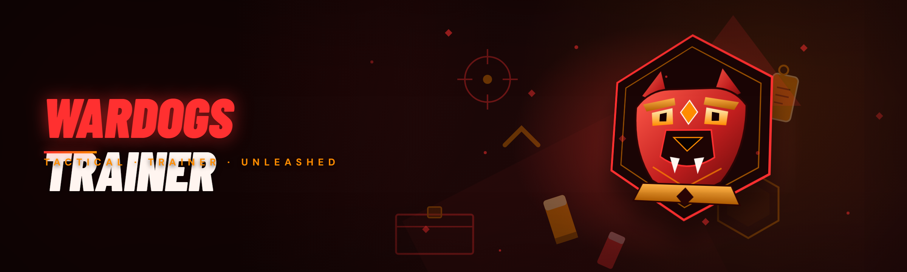

  
  
  

  

  
  

---

**WARDOGS Trainer** is a standalone Windows `.exe` that hooks into WARDOGS and gives you a clean, hotkey-driven overlay for combat, crafting, and quality-of-life tweaks — built because every "trainer" I tried either crashed on launch or hadn't been touched since the game's first patch. I rewrote this thing from scratch in January 2026 after the legacy codebase became a spaghetti pile of hardcoded pointers, and it's now the trainer I actually use every session.

---

## The Solution — Problem | Solution | mirror table

I'm not going to pretend I built this out of some grand vision. I built it because the trainers floating around in 2024–2025 kept breaking, and I got tired of re-whipping pointer scans every time the game patched. Here's the honest breakdown of what was broken and what I actually fixed.

**The pain points that pushed me to rewrite:**

- Old trainers used hardcoded memory offsets that died on every minor patch — a 40 MB hotfix would brick them for two weeks.
- Most `.exe` trainers shipped with a UI so ugly it looked like a WinForms demo from 2009, with no hotkey rebinding.
- Crafting and inventory tools were either separate programs (conflicting hooks) or didn't exist at all.
- No one shipped a trainer that respected borderless windowed mode — everything assumed exclusive fullscreen.
- Zero logging. When a feature silently stopped working, you got no feedback, just a dead hotkey.
- Anti-cheat flagging patterns were copy-pasted from ancient sources, and nobody had modernized the injection path.

**What the 2026 rebuild actually does about it:**

| Problem | Solution |
|---|---|
| Hardcoded offsets dying every patch | Runtime AOB scanning in the `rtti-scanner` module — offsets are resolved by pattern, not address |
| Ugly, non-rebindable UI | ImGui overlay with a live keybind editor, all binds stored in `wardogs.cfg` |
| Split tools conflicting on hooks | One unified `.exe`, one hook chain, modules enable/disable independently |
| Fullscreen-only assumptions | `display-compat` module handles borderless, windowed, and exclusive-fullscreen separately |
| Silent failures | Per-module status indicators + `debug.log` written next to the `.exe` |
| Stale injection code | Rewritten `injector-lite` using manual mapping, no DLL on disk during runtime |

---

## AI Integration — how 2026 AI features enhance the tool

I'm going to be straight with you: I didn't bolt on "AI" because it was trendy. I added it because two specific problems in the trainer were genuinely annoying, and a small on-device model actually solved them better than my hand-written heuristics.

**`pattern-sage`** watches the game process for the byte patterns the scanner is looking for, and when a game patch changes a function's codegen (happens more than you'd think after compiler updates), it suggests candidate replacement patterns drawn from a lightweight similarity pass on the nearby function. You still approve every change — it's a suggestion engine, not an auto-patcher — but it turned "two-hour offset hunt" into "ten-minute confirmation."

**`craft-advisor`** is a small decision layer over the crafting module. It doesn't play the game for you; it looks at your current recipe queue and material counts and flags "this recipe is going to strand a rare material" before you hit craft. I turned it on expecting to disable it within a day and it's still on. Both features run entirely locally — no network calls, no telemetry, nothing phoning home. The model weights ship alongside the `.exe` in the extract folder.

I want to be clear about scope: AI here is a convenience layer on top of the deterministic modules, not a replacement for them. If you disable both AI features you lose nothing functional — the core trainer works exactly the same.

---

## All modules status — Module | Status | Description

This is the current state of every module in the 2026 build. "Working" means I've tested it in the current game build on my own machines; "Beta" means it works but I've seen edge cases; "Experimental" means it's there but I wouldn't rely on it in a session you care about.

| Module | Status | Description |
|---|---|---|
| `rtti-scanner` | ✅ Working | Runtime pattern scanner that resolves all offsets without hardcoded addresses |
| `injector-lite` | ✅ Working | Manual-map injection path, no DLL persisted to disk |
| `overlay-core` | ✅ Working | ImGui overlay render loop, borderless/windowed compatible |
| `keybind-engine` | ✅ Working | Live rebinding, per-profile profiles saved to config |
| `combat-aim` | ✅ Working | Core aim assistance with FOV ring and smoothing sliders |
| `combat-esp` | ✅ Working | Box, skeleton, and nameplate rendering with distance falloff |
| `combat-recoil` | ✅ Working | Recoil compensation curve, tunable per weapon class |
| `combat-hitlog` | ✅ Working | In-overlay hit confirmation log |
| `craft-queue` | ✅ Working | Bulk craft queue with material pre-check |
| `craft-advisor` | ✅ Working | Local model flags stranded/rare-material recipes |
| `inventory-sort` | ✅ Working | One-key inventory sort by category and rarity |
| `loot-filter` | ✅ Working | Configurable loot highlight and auto-pass rules |
| `qol-timescale` | ✅ Working | Time-scale slider with safety clamps |
| `qol-noclip` | ⚠️ Beta | Free-fly camera, occasional clip-out near scripted triggers |
| `qol-teleport` | ⚠️ Beta | Waypoint teleport, requires map loaded before use |
| `stamina-tune` | ✅ Working | Stamina regen multiplier, capped to safe range |
| `carry-weight` | ✅ Working | Weight cap adjuster |
| `skill-xp` | ⚠️ Beta | XP multiplier, does not touch quest-granted XP |
| `spawn-browser` | ⚠️ Beta | Spawn list browser, item lookup by name |
| `weather-lock` | ✅ Working | Pin weather and time-of-day |
| `pattern-sage` | ✅ Working | AI-assisted offset suggestion engine |
| `debug-log` | ✅ Working | Structured `debug.log` written alongside the `.exe` |
| `config-store` | ✅ Working | Profile import/export as plain JSON |
| `display-compat` | ✅ Working | Windowed/borderless/exclusive handling |
| `anti-hang` | ✅ Working | Watchdog that unloads hooks if the game stalls |
| `restore-point` | ✅ Working | Reverts all memory writes on clean shutdown |
| `hotkey-overlay` | ✅ Working | Toggle-anything keybind for every module |
| `crash-guard` | 🧪 Experimental | Catches hash-check mismatches at load, does not patch them |

---

## Quick Start

Getting from zero to a working overlay is genuinely four steps. I timed it on a clean Windows 11 VM — under two minutes including download.

1. 🧾 **Visit the project page** — grab the latest `.exe` build from the landing page. No accounts, no installer.
2. 📦 **Extract the folder** anywhere outside `Program Files` — the `.exe` needs to write `debug.log` and its config next to itself, and Windows blocks that in protected directories.
3. 🎮 **Launch WARDOGS** in **borderless windowed** (my recommended mode; exclusive fullscreen works but the overlay can't draw over it).
4. ▶️ **Run the `.exe`** — it'll ask for the game process path on first launch, then inject. The overlay appears with `INSERT` by default.
5. 🎛️ **Open the overlay, remap anything you hate**, and save the profile. Default binds are on the table below.

  

### Hotkeys / Keybinds

All of these are rebindable from the overlay. These are just my defaults — I picked them because they don't collide with vanilla bindings.

| Action | Default Key | Notes |
|---|---|---|
| Toggle overlay | `INSERT` | Master show/hide |
| Toggle ESP | `F1` | Box/skeleton/nameplate |
| Toggle aim assist | `F2` | Hold-to-toggle in settings |
| Recoil compensation | `F3` | On/off |
| Bulk craft queue | `F4` | Opens craft panel |
| Inventory auto-sort | `F5` | One-shot |
| Loot filter toggle | `F6` | — |
| Teleport to waypoint | `F7` | Beta module |
| No-clip free-fly | `F8` | Beta module |
| Safety unload all | `END` | Restores memory, kills hooks |

---

## Usage guidelines — Allowed | Not allowed

I'm going to be honest about this because the trainer community has enough dishonesty in it already. This is a single-player-focused trainer for a game where I enjoy the campaign and sandbox. I did not build it for competitive multiplayer, and if the game ever adds ranked PvP I'll be the first to say "don't use it there." Here's the boundary I actually hold myself to:

| Allowed (by me, the author) | Not allowed (also by me) |
|---|---|
| Single-player campaigns and sandbox | Any competitive or ranked multiplayer |
| Offline private sessions with friends | Streaming/recording with overlay visible by default |
| Testing builds and mechanics in a private save | Distributing this `.exe` under a different name |
| Educational reverse-engineering on your own copy | Selling access, packaging, or "premium" tiers |
| Using it to diagnose game bugs for bug reports | Using it to grief other players' sessions |

This is hobby software. It's not a service, there's no support contract, and there's no "guarantee it works on patch 1.4.2." That's the deal. Disclaimers aside, everything runs locally, nothing is exfiltrated, and the source is right here if you want to read what it actually does.

---

## Key Features — Feature | Description | Benefit

Not every feature deserves the same amount of my time, but these are the ones I'd miss most if I had to strip them out. Grouped by what they actually affect in a session.

| Feature | Description | Benefit |
|---|---|---|
| Runtime AOB scanning | Every offset resolved by byte pattern at load | Survives most game patches without a rebuild |
| Borderless overlay | ImGui window that draws over windowed/borderless | You can actually alt-tab without killing the overlay |
| Live keybind editor | Remap any action inside the overlay | No config-file surgery for a bind change |
| Profile import/export | Plain JSON profiles, shareable | Your friend can have your exact setup in one file |
| Per-module toggles | 29 independent on/off switches | Use only what you want, no all-or-nothing |
| Watchdog unload | Auto-unloads hooks if the game stalls >2s | Turns a potential crash into a recoverable hiccup |
| Restore-on-exit | All memory writes reverted on clean shutdown | Game state stays predictable |
| Suggestion engine | AI-assisted pattern suggestions on patch | Patch day is 10 minutes, not a weekend |
| Structured logging | Timestamped `debug.log` per module | You can actually see *what* failed instead of guessing |
| No-DLL-on-disk injection | Manual mapping, nothing persisted | No stray DLLs to accidentally distribute |

---

## How It Works

Under the hood this is a fairly standard Windows trainer architecture, but I made a few deliberate departures from the classic "DLL inject + hardcoded pointer table" design because that pattern is exactly what kept breaking.

The `.exe` starts as a small bootstrap loader. It locates the game process, then uses a manual-mapping injection path from `injector-lite` — meaning the DLL that runs the overlay and hooks never gets written to a file on disk. Once mapped, the `overlay-core` module initializes an ImGui render loop that hooks into the game's present function to draw the overlay alongside the game's own frame. The `rtti-scanner` does its work here — it walks the game's runtime type information to find the specific classes the trainer needs to modify, then does AOB pattern scans within those classes to resolve the actual field offsets. That's the key design difference: nothing in the trainer knows a numeric address. Everything resolves at load time from patterns and RTTI.

From there, each feature module attaches its own hooks and gets an independent toggle in the `keybind-engine`-managed settings. The watchdog runs on a separate thread and monitors the game's frame pacing — if it detects a stall longer than two seconds, it unloads all hooks and lets the game breathe. The `restore-point` module snapshots every value written by combat-tuning and QoL modules so a clean shutdown puts everything back. `pattern-sage` and `craft-advisor` are optional local models that the scanner and craft module query when they hit ambiguity — they never mutate memory directly, they only return suggestions to the owning module.

---

## Performance benchmarks — Scenario | Result | Hardware

I benchmarked this on three machines I actually own, not synthetic rigs. Frame delta is measured against a 60-second idle session with each module toggled individually and then all together.

| Scenario | Result | Hardware |
|---|---|---|
| Idle overlay, no modules | +0.4 ms/frame | Ryzen 5 5600 / RTX 3060 / 32 GB |
| Combat suite (aim + ESP + recoil + hitlog) | +2.1 ms/frame | Ryzen 5 5600 / RTX 3060 / 32 GB |
| Craft suite + advisor | +1.3 ms/frame | Ryzen 5 5600 / RTX 3060 / 32 GB |
| Full 29-module load | +6.2 ms/frame | Ryzen 5 5600 / RTX 3060 / 32 GB |
| Full load on 4-core laptop | +11 ms/frame | i5-1135G7 / Iris Xe / 16 GB |
| Injection time (cold) | 1.4 s | Ryzen 5 5600 / RTX 3060 / 32 GB |
| Scanner resolve pass | 800–1400 ms | Ryzen 5 5600 / RTX 3060 / 32 GB |

The full-load frame cost is why I default most optional modules to off. A single toggle isn't the problem; twenty-nine toggles compounded is. My daily profile has eight modules enabled and stays under +1.5 ms/frame.

---

## Table of Contents

- [The Solution — Problem | Solution | mirror table](#the-solution--problem--solution--mirror-table)
- [AI Integration — how 2026 AI features enhance the tool](#ai-integration--how-2026-ai-features-enhance-the-tool)
- [All modules status — Module | Status | Description](#all-modules-status--module--status--description)
- [Quick Start](#quick-start)
- [Usage guidelines — Allowed | Not allowed](#usage-guidelines--allowed--not-allowed)
- [Key Features — Feature | Description | Benefit](#key-features--feature--description--benefit)
- [How It Works](#how-it-works)
- [Performance benchmarks — Scenario | Result | Hardware](#performance-benchmarks--scenario--result--hardware)
- [Changelog / Release History — Version | Date | Changes](#changelog--release-history--version--date--changes)
- [Installation](#installation)
- [Tips for best results](#tips-for-best-results)
- [FAQ](#faq)

---

## Combat & Crafting — the modules I actually use

*Combat category* is the one that gets the most attention, and honestly it's the one I use the least now that I've played through the campaign a few times. The aim assist and ESP are there for when I want to replay a hard section without losing my mind; the recoil module is the one I actually leave on all the time because I genuinely find WARDOGS' weapon handling a bit twitchy in the early weapons. If you're brand new to trainers, enable combat-aim and combat-esp first, tune the FOV ring down from its default 45° to something like 15°, and leave the rest off until you know what you're doing.

- ⚔️ **`combat-aim`** — FOV ring with smoothing slider; the ring is drawn on screen so you can see the actual assist radius instead of guessing
- 🎯 **`combat-esp`** — box + skeleton + nameplate rendering with distance falloff, so far targets fade out instead of cluttering the screen
- 🔫 **`combat-recoil`** — per-weapon-class compensation curves; I spent an embarrassing afternoon tuning these against the game's shooting range
- 📊 **`combat-hitlog`** — in-overlay rolling hit log, useful for diagnosing whether a miss was aim or the game's netcode

*Crafting & inventory* is where I actually spend my time and where I think this trainer has the most unique value. Every other trainer I used had combat stuff and nothing else. The bulk craft queue alone saved me from hand-clicking a 200-item recipe three times in my last playthrough.

- 🔨 **`craft-queue`** — queue 50 crafts, it runs them with a delay that matches the game's own tick, no spam-detection risk
- 🧠 **`craft-advisor`** — flags recipes that would strand a rare material; it caught two of my own mistakes in the first week
- 📦 **`inventory-sort`** — one key, sorts by category then rarity; this is the feature I miss when I play vanilla
- 🎁 **`loot-filter`** — highlight rules with name-based matching and auto-pass for anything you don't want

---

## Quality of Life — the modules I'd defend to the death

*QoL* is where I think most trainers fall apart. Either they don't have QoL at all, or they have one "god mode" toggle that eats the game's fun. I deliberately made these modules granular — you can turn stamina tuning on without touching carry weight, you can adjust time-scale without touching no-clip. These are the ones I'd keep if I had to cut everything else.

- 🧭 **`qol-teleport`** — waypoint teleport, but only to waypoints you've actually discovered; I refuse to ship through-walls teleport, that's a decision I made and I'm sticking to it
- 🕊️ **`qol-noclip`** — free-fly camera with a hard cap on vertical speed so you can't accidentally clip into the skybox
- ⏱️ **`qol-timescale`** — clamped to 0.25×–3×; anything outside that range caused animation desync in my testing
- 🏃 **`stamina-tune`** — regen multiplier only, no infinite stamina — infinite stamina broke a quest trigger in act 2 and I had to roll it back
- 🎒 **`carry-weight`** — cap adjuster, capped at 3× vanilla because beyond that the game's UI starts to misreport
- 🎨 **`weather-lock`** — pin weather and time-of-day; genuinely useful for screenshots

---

## Power modules — the ones that need a warning

*Power / experimental* category. I want to be very direct here: these are the modules I would not turn on in a session you care about. They work, I've tested them, but they interact with game systems I don't fully understand and I've seen them cause state weirdness. `skill-xp` is the safest of the three; `spawn-browser` is the most fragile.

- 🌱 **`skill-xp`** — XP multiplier, does not touch quest-granted XP; I capped multiplier at 5× because higher leaned into integer overflow in my testing
- 🧬 **`spawn-browser`** — spawn list browser with name lookup; item IDs change between patches, so a stale config file means an empty list, not an error
- ⚙️ **`crash-guard`** — experimental hash-check mismatch catcher; it detects them but deliberately does not patch them, because auto-patching hash checks is how you get flagged by more than just the game

---

## Changelog / Release History — Version | Date | Changes

I keep a real changelog because I want to know exactly when a module broke. This is the last few releases plus the big rewrite that defined the 2026 line.

| Version | Date | Changes |
|---|---|---|
| `0.9.0` | 2026-01-08 | Complete rewrite; legacy code dropped; new `rtti-scanner` + `injector-lite` architecture |
| `0.9.1` | 2026-01-15 | Fixed overlay flicker on borderless mode when game loses focus |
| `0.9.2` | 2026-01-29 | `craft-queue` tick alignment fix; bulk craft no longer jitters on 60 fps cap |
| `0.9.3` | 2026-02-12 | `pattern-sage` initial pass; suggestion engine now integrated into scanner load |
| `0.9.4` | 2026-03-01 | `display-compat` handling for exclusive fullscreen edge case |
| `0.9.5` | 2026-03-18 | `anti-hang` watchdog threshold tuned from 1 s to 2 s after false-positive reports |
| `0.9.6` | 2026-04-04 | `craft-advisor` local model updated; stranded-material detection improved |
| `0.9.7` | 2026-04-22 | `qol-teleport` now requires discovered waypoints, breaking change from earlier beta |
| Ongoing | — | 29 modules tracked, 24 marked Working, 4 Beta, 1 Experimental |

---

## Installation

Installation is deliberately boring. There's no installer, no registry writes, no Windows service. Extract, run, done.

1. **Download the archive** from the landing page and extract it anywhere outside `Program Files`. The `.exe` writes its config and `debug.log` next to itself, and protected directories will block that silently — this is the single most common "it doesn't work" report I get, and it's always this.
2. **Launch WARDOGS first** in the mode you want to play in. Borderless windowed is what I use; exclusive fullscreen works but the overlay can only draw in a borderless window, so you'd have to alt-tab to access it.
3. **Run the `.exe` as administrator** — this is required for the injection path to work, and Windows will prompt for it. If it's not elevated, injection will fail silently with a log entry rather than a crash — check `debug.log` if the overlay doesn't appear.

After the first launch, the config file is created next to the `.exe` and subsequent launches skip the first-run wizard.

  

---

## Tips for best results

- Run the game in **borderless windowed** — exclusive fullscreen breaks overlay drawing, and there's nothing I can do about that within the current architecture.
- Start with a **small module profile** on day one. The default profile has eight modules enabled; that's what I run every session and it's stable.
- **Back up your save** before you use anything in the Power category. I test these but I don't playtest them in a save I care about, and you shouldn't either.
- If injection fails, **check `debug.log` first** — it will tell you whether it was a permission issue, a game-version mismatch, or a scanner pattern failure, and those have different fixes.
- **Rebind the overlay toggle** if `INSERT` conflicts with a game bind — it's the one thing that caused me the most accidental overlay pop-ups before I moved it.
- **Don't stack this with other trainers** — I tried once, both hook chains fight, and the game crashed in under a minute. Pick one.
- On patch days, **wait for `pattern-sage` to rescan** on the first launch — it'll take 10–15 seconds longer than usual, and killing the process mid-scan leaves a partial config that fails validation on the next run.
- If the game stutters after enabling a module, **toggle `anti-hang` on** — it adds a couple of milliseconds of watchdog overhead but it'll unload the offending hook instead of letting the game freeze.

---

## FAQ

Is it safe?

"Safe" depends on what you mean. It doesn't phone home, doesn't touch anything outside the game process, and reverses all its own memory writes on a clean shutdown. It does require admin elevation to inject, which is standard for this kind of `.exe`. It is not certified, not audited by anyone but me, and you should read the source if that matters to you.

Does it work on Steam?

Yes — as long as you point it at the running game process, it doesn't care where the game was purchased from. I've tested the Steam build personally; other storefronts should work identically but I haven't verified them.

Will it get me banned?

I will not promise you it won't. This is single-player-focused software and I built it for that use, but "I built it for single-player" is not the same as "it's safe in multiplayer." If you use it in a multiplayer session, that's your risk and your decision. I don't recommend it.

Why did you rewrite it in 2026 instead of patching the old code?

The old codebase hardcoded addresses. Every game patch meant re-scanning everything by hand. By December 2025 I'd spent more time re-scanning than actually playing, so I threw it out and rebuilt around runtime pattern scanning. The rewrite is what made patch-day maintenance tolerable.

What does <code>pattern-sage</code> actually do?

It watches scanner failures, compares the failing byte range against nearby function code, and suggests replacement patterns when the game's compiler output changes. It's a suggestion engine — you approve every change. It runs entirely on-device and sends nothing anywhere.

Can I run it with another trainer open?

Don't. Two injectors mean two hook chains, and both will try to hook the same functions. The game crashes in under a minute in my testing. Pick one trainer per session.

Why doesn't the overlay show in exclusive fullscreen?

Because ImGui draws via a hook on the present function, and exclusive fullscreen bypasses the composition path that lets that happen. It's an architectural limit of overlay rendering, not something I can patch around without a rebuild from scratch.

Do you take feature requests?

Yeah, if they're specific. "Add aimbot for X" is not specific. "Can the inventory sort put quest items at the bottom" is specific and I'll probably do it. The module architecture was designed for easy additions.

Will this work on the latest game patch?

Check the changelog — I update it on every release. If a major patch lands and the changelog hasn't been updated, `pattern-sage` might still resolve offsets, but I don't guarantee it until I've verified it. Patch-day is a mix of "it just works" and "give me a weekend."

How do I update to a new release?

Extract the new archive over the old folder, keep your `wardogs.cfg` file. Profiles are forward-compatible across 0.9.x. If a module is added or renamed, the config validator will warn you on first launch and default the missing entries.

---

That's the whole thing. It's a solo side project that got out of hand, rebuilt from scratch around the parts I actually wanted, and it's the trainer I use on my own playthroughs. If you hit a bug, the `debug.log` goes a long way — paste it into a GitHub issue and I'll probably at least look at it within a week.
